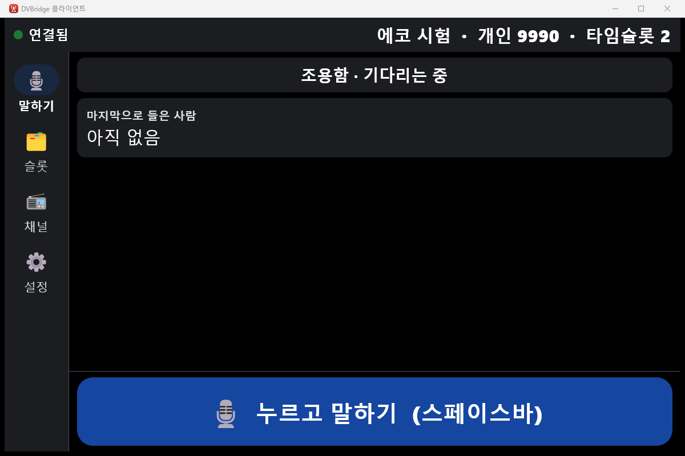
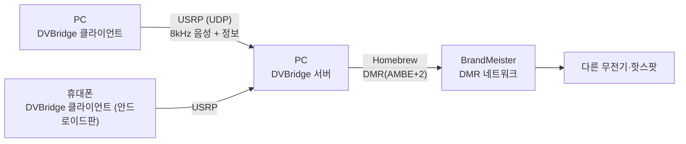
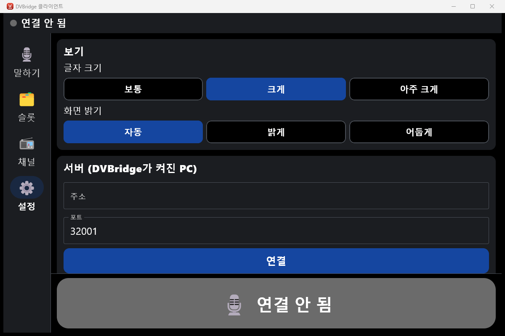

# DVBridge 클라이언트 — PC (Windows)

**[DVBridge](https://github.com/seunghunchoi-dev/dvbridge) 전용 Windows 프로그램**입니다.
DVBridge 서버에 붙어서 BrandMeister 등 DMR 네트워크의 무전을 PC로 듣고, 스페이스바나 큰 버튼을 눌러 말할 수 있습니다.
휴대폰판과 **같은 메뉴 4개**(말하기·슬롯·채널·설정)를 PC 화면에 맞게 왼쪽 세로 줄로 놓고, 맨 아래에 가로로 긴 말하기 버튼을 둡니다.

> 0.4까지는 **DMRBridge 클라이언트**라는 이름이었습니다. DMR 말고 다른 디지털 방식도 담을 수 있게 0.5부터 **DVBridge**로 바꿨습니다(서버도 함께).



| | |
|---|---|
| 제작자 | **6K2KZR 최승훈** |
| 라이선스 | [MIT](LICENSE) — 자유롭게 사용·수정·재배포 (저작자 표기 유지) |
| 내려받기 | [Releases](https://github.com/seunghunchoi-dev/dvbridge-client-pc/releases) — `DVBridgeClient-0.5.1-setup.exe` |
| 설명서 | [Wiki](https://github.com/seunghunchoi-dev/dvbridge-client-pc/wiki) (사진과 함께 따라 하기) · 설치 폴더와 Releases의 PDF |
| 같은 앱의 휴대폰판 | [dvbridge-client-android](https://github.com/seunghunchoi-dev/dvbridge-client-android) — 화면·기능 같음 |
| 서버 | [dvbridge](https://github.com/seunghunchoi-dev/dvbridge) — 이 프로그램이 붙는 Windows 브리지 프로그램 |

> ※ 송신은 아마추어 무선국 허가(콜사인)와 DMR ID가 있는 분만 하세요.

---

## DVBridge와의 관계

**DVBridge**는 같은 제작자가 만든 Windows용 아마추어 무선 브리지 프로그램입니다.
PC에서 BrandMeister 같은 DMR 마스터에 핫스팟처럼 접속해 두고, 여러 사람의 휴대폰·PC를 그 서버에 붙여 무전을 주고받게 해 줍니다.
이 프로그램은 그 **PC 쪽 단말**입니다. DVBridge가 돌아가는 같은 PC에서 써도 되고, 같은 네트워크의 다른 PC에서 써도 됩니다.



- **음성 변환(보코더)은 서버가 합니다.** 이 프로그램은 일반 음성(8kHz)만 주고받으므로 보코더가 없고, 따로 구할 것도 없습니다.
- **사용자마다 포트가 따로 있습니다.** 서버 운영자가 DVBridge 웹 설정에서 사용자를 만들면 그 사람의 USRP 포트(예: 32001)가 정해집니다. 같은 PC면 주소는 `127.0.0.1`.
- **송신 콜사인·DMR ID는 서버 설정 값**이 쓰입니다(BrandMeister 접속은 서버가 하기 때문).
- DVBridge의 기능을 화면에서 그대로 보여 줍니다.
  - **브릿지 공지** — 운영자가 보낸 음성 공지(문장 읽어 주기·마이크 방송·예약 공지)를 "📢 브릿지 공지"로 표시
  - **내부 채널** — BrandMeister로 나가지 않고 같은 브리지 사용자끼리만 이야기하는 채널(기본 TG 99)
  - **상대방 정보** — 서버가 RadioID 명단에서 찾은 콜사인·이름·지역, 상대 무전기가 보낸 이름표(Talker Alias)
  - **서버 알림** — 채널 변경 결과 등 서버가 보내는 안내
- 운영자는 이 프로그램으로 브리지가 잘 동작하는지 PC에서 바로 듣고 시험할 수 있습니다.

통신 규격은 [docs/PROTOCOL.md](docs/PROTOCOL.md)에 정리돼 있습니다.

---

## 화면과 기능

메뉴는 휴대폰판과 **똑같이 4개**입니다. 창이 넓으면 메뉴가 왼쪽 세로 줄에, 좁히면 휴대폰처럼 아래에 놓입니다.

| 자리 | 내용 |
|---|---|
| 맨 위 | 연결 상태 · **지금 채널을 크게**(이름 · 번호 · 타임슬롯) |
| 왼쪽 | 메뉴 4개 — 🎙 말하기 · 🗂 슬롯 · 📻 채널 · ⚙ 설정 (휴대폰과 같은 순서·같은 그림) |
| 가운데 | 고른 메뉴의 화면 |
| 맨 아래 | **가로로 긴 말하기 버튼** — 어느 메뉴에서나 바로 누를 수 있음 (스페이스바도 됨) |

### 🎙️ 말하기
- **스페이스바**를 누르고 있는 동안 송신 (글자 입력 칸에 커서가 있을 때는 제외), 또는 큰 버튼
- 설정에서 **한 번 눌러 켜고 다시 눌러 끄기**를 고를 수 있음
- 맨 위: 조용함 / 누가 말하는 중 / 내가 말하는 중(시간)
- **마지막으로 들은 사람**: 콜사인 · 이름 · 지역 · 상대 무전기 이름표, 브릿지 공지·내부 채널 표시
- 송신은 한 번에 **180초**가 넘으면 자동으로 멈춤

### 🗂️ 슬롯 (채널 메모리)
- 자주 쓰는 TG·개인호출을 **개수 제한 없이** 저장, 누르면 바로 그 채널로 (넓은 화면에서는 채널 버튼 타일로, 칸 너비에 맞춰 2~5개씩)
- **＋ 번호로** 타일 → 채널 메뉴, **✎ 고치기**를 켜고 타일을 누르면 그 채널 고치기
- 이름 · 번호 · 개인호출 · **타임슬롯 1/2** · 그룹, **★ 즐겨찾기**, 그룹별 보기, **검색**, **크게/간단히**

### 📻 채널
- 지금 통화 대상, 번호로 바꾸기(그룹/개인호출), **타임슬롯 1/2**, 🔁 내부 채널

### ⚙️ 설정



- **보기**: 글자 크기 3단계, 화면 밝기(자동·밝게·어둡게)
- **서버**: 주소 · 포트 · 연결/연결 끊기
- **내 정보**: 콜사인 · DMR ID · 이름 · 장비명(비우면 "PC") → 서버로 보냄
- **말하기·소리**: 누르기 방식, 듣는 소리·마이크 크기, 스피커 시험
- **소리 장치 (PC)**: 스피커·마이크 선택. 처음 값 **Windows 통신 장치**는 Windows 소리 설정의 "기본 통신 장치"(보통 헤드셋)를 따라감 — 모니터 스피커가 기본 장치여도 헤드셋으로 나옴
- **프로그램을 켜면 자동으로 연결**
- **기록 보기**

### 내 정보와 이름표
장비명은 DVBridge가 받아서 상대 무전기 **이름표**(예: `N0CALL DVBridge PC`, 31자)와 BrandMeister **기기 위치** 칸(`DVBridge PC`, 20자)에 씁니다.

### 그 밖에
- 한 번에 하나만 실행 (같은 마이크를 두 프로그램이 잡지 않게)
- 연결이 끊기면 스스로 다시 연결
- 설정 저장 위치: `%APPDATA%\DVBridgeClient`

---

## 설치와 처음 설정

1. [Releases](https://github.com/seunghunchoi-dev/dvbridge-client-pc/releases)에서 `DVBridgeClient-0.5.1-setup.exe`를 받아 실행합니다 (Windows 10/11 64비트).
   - 관리자 권한이 필요 없고 현재 사용자에게만 설치됩니다. **Java가 함께 들어 있어** 따로 깔 것이 없습니다.
   - 서명이 없는 개인 프로그램이라 "Windows의 PC 보호"가 나오면 **추가 정보 → 실행**.
2. **설정 → 서버**에 DVBridge 운영자에게 받은 **주소**와 **포트**를 넣고 **연결** (같은 PC면 `127.0.0.1`).
3. 위쪽에 🟢 **연결됨**이 나오면 끝. **내 정보**에 콜사인·DMR ID·이름을 넣고 저장합니다.
4. 필요하면 **소리 장치**를 고르고 "자동으로 연결"을 켭니다.

지우기: Windows 설정 → 앱 → 설치된 앱 → **DVBridge 클라이언트** → 제거.
자세한 내용과 문제 해결은 [Wiki](https://github.com/seunghunchoi-dev/dvbridge-client-pc/wiki)를 보세요.

---

## 개인정보

- 입력한 서버 주소·콜사인·DMR ID·이름·장비명은 **사용자가 지정한 DVBridge 서버에만** 보냅니다.
- 마이크는 **말하는 동안에만** 열리며, 음성은 저장하지 않습니다.
- 광고·분석 도구·계정 로그인이 없습니다. 처음 설치하면 모든 칸이 비어 있습니다.

---

## 소스에서 빌드하기

| 필요한 것 | 버전 |
|---|---|
| JDK (jlink·jpackage 포함) | 17 (Eclipse Temurin 17에서 시험) |
| Gradle | 8.9 (wrapper 포함) |
| Inno Setup | 6 (설치 파일을 만들 때만) |

```bat
build_desktop.bat     :: 실행 폴더 → composeApp\build\compose\binaries\main\app\DVBridgeClient
build_pc_setup.bat    :: 설치 파일 → C:\dev\dmrc-build\setup\DVBridgeClient-<버전>-setup.exe
                      ::   set MANUAL=설명서.pdf 를 먼저 지정하면 설명서를 함께 넣음
```

- jlink·jpackage는 경로에 영문이 아닌 글자가 있으면 실패하므로, 설치 파일은 `-Pdmrc.buildDir=C:/dev/dmrc-build`(영문 폴더)로 빌드합니다. 소스 폴더도 영문 경로(또는 `mklink /J`)를 권합니다.

### 구조

| 경로 | 내용 |
|---|---|
| `composeApp/src/jvmShared` | **안드로이드판과 똑같은 공통 코드** — USRP 통신(`UsrpClient`), 상태·송신 제한(`Radio`), 소리 변환(`Resampler`), 화면 전체(`App`, Compose) |
| `composeApp/src/desktopMain` | PC 전용 — Java Sound 48kHz 입출력(`DesktopAudio`), Windows 통신 장치 이름(JNA·Core Audio, `DesktopPlatform`), 창·스페이스바·한 번만 실행(`Main`) |
| `packaging` | 설치 파일 스크립트(Inno Setup), MIT 사용권, 오픈소스 고지(`THIRD_PARTY_NOTICES.txt`, `LICENSES/`) |
| `docs/PROTOCOL.md` | 클라이언트 ⇄ DVBridge 통신 규격 |

Kotlin Multiplatform + Compose Multiplatform으로 안드로이드판과 화면·통신 코드를 함께 씁니다.

---

## 사용한 오픈소스

설치 파일에 함께 들어가는 부품 (자세한 고지: [packaging/THIRD_PARTY_NOTICES.txt](packaging/THIRD_PARTY_NOTICES.txt))

| 부품 | 라이선스 |
|---|---|
| Eclipse Temurin 17 (Java 실행 환경, 필요한 모듈만) | GPL v2 + Classpath Exception |
| Kotlin, kotlinx, Compose Multiplatform, Skiko, AndroidX 일부, JetBrains Annotations | Apache License 2.0 |
| JNA, JNA Platform | Apache License 2.0 (LGPL 2.1과 이중 라이선스 중 Apache 2.0 선택) |
| Skia | BSD 3-Clause |
| ICU 데이터 | Unicode License V3 |

아이콘은 제작자가 직접 그렸습니다(DVBridge와 같은 아이콘). 보코더(AMBE+2)는 들어 있지 않습니다.

## 관련 프로젝트

- [DVBridge](https://github.com/seunghunchoi-dev/dvbridge) — 이 프로그램이 붙는 Windows용 DMR 브리지 서버 (MIT)
- [DVBridge 클라이언트 안드로이드판](https://github.com/seunghunchoi-dev/dvbridge-client-android) — 같은 앱의 휴대폰판 (MIT)

BrandMeister, RadioID는 각 소유자의 이름이며, 이 프로젝트는 그들과 제휴하지 않은 독립 프로젝트입니다.

---

설정 폴더: `%APPDATA%\DVBridgeClient` (0.4의 `%APPDATA%\DMRBridgeClient` 설정은 처음 실행할 때 자동으로 옮겨 옴)

MIT License · Copyright (c) 2026 최승훈 (Choi Seunghun, **6K2KZR**)
